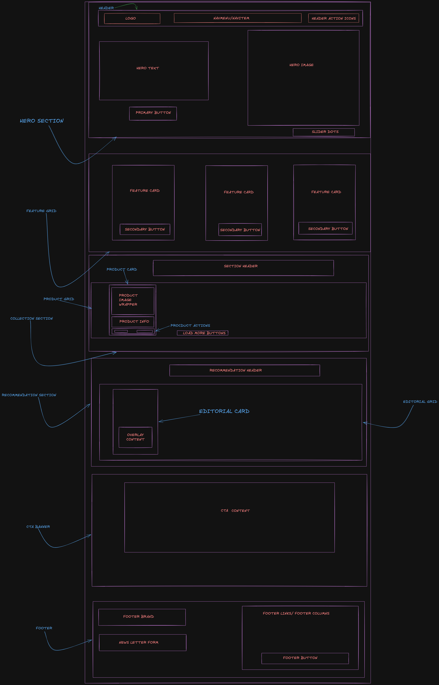

# ECommerce

A responsive web storefront created to practise end-to-end web development and state management.
Users can browse catagorized catalogs based on `women`, `men`, `kids`, `accessories`, `collection`, `brands`, manage realtime shopping cart updates, track order histories, and authenticate securely, while admins can perform full CRUD operations on inventory. Build with React, Typescript.

## Getting Started

```bash
git clone <repo-url>
cd shopping-cart
npm install
npm run dev
```

## Wire Frame Mapping



Prefer SVG? [Open the SVG wireframe](./public/eCommerceSVG.svg).

🔗 _[Live Demo](https://shopping-cart-ebyk.onrender.com/)_ | 📹 _[Video Walkthrough](your-link-here)_

## ✨ Key Features

- _Storefront & Discovery:_ Search, filter by category/price, and sort products dynamically.
- _Shopping Cart:_ Persistent cart state across sessions with real-time subtotal calculations.
- _User Authentication:_ Secure sign-up, login, and order history tracking using _[Auth method, e.g., JWT / NextAuth]_.
- _Checkout Flow:_ Integrated payment processing with _[Stripe ]_.
- _Admin Dashboard:_ (Optional) Create, update, and delete products and manage order statuses.

## 🛠️ Tech Stack

- _Frontend:_ [ React, Redux Toolkit, Tailwind CSS, TypeScript]
- _Backend:_ [ Node.js, Express]
- _Database:_ [ MongoDB / PostgreSQL]
- _Payments & Auth:_ [ Stripe API, Firebase Auth]

## Routes

| Path           | Page        | Description                         |
| -------------- | ----------- | ----------------------------------- |
| `/`            | Home        | Landing page with featured products |
| `/women`       | Women       | Women's catalog                     |
| `/men`         | Men         | Men's catalog                       |
| `/kids`        | Kids        | Kids' catalog                       |
| `/accessories` | Accessories | Accessories                         |
| `/collection`  | Collection  | Curated collections                 |
| `/brands`      | Brands      | Brand directory                     |
| `*`            | Error       | Error directory                     |

All routes share a single `Layout` (sticky header, centered `<main>` content box, footer) via a pathless parent route and `<Outlet />`.

## Architecture

- **Single layout via `<Outlet />`** — header and footer render once; only `<main>` swaps per route. The sticky header doesn't remount on navigation.
- **`BrowserRouter` mounted in `main.tsx`** — so any component can call `useNavigate`, `useParams`, and `useLocation` without prop-drilling or extra providers.
- **Width on `<main>`, arrangement on inner `<div>`** — the content box (`max-w-6xl`, `mx-auto`) and the grid/flex rules live on separate elements, so layout changes don't fight sizing.
- **Folder structure** — `pages/` = one file per route; `components/features/` = domain features (Header, Hero, Cart); `components/ui/` = reusable primitives (button, card, sheet, carousel); `layouts/` = shells.
